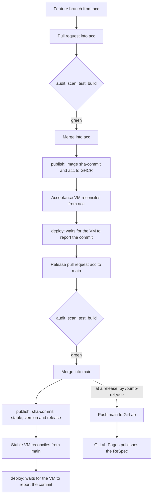

# CPRMV

[](https://github.com/open-regels/cprmv/actions/workflows/ci.yml)
[](https://github.com/open-regels/cprmv/actions/workflows/zizmor.yml)
[](https://github.com/open-regels/cprmv/actions/workflows/semgrep.yml)

The **Core Public Rule Management Vocabulary** (CPRMV) is an RDF vocabulary for
describing public rules: the rule sets that governments publish, the methods
with which those rules are written, published, referenced and serialised, and the
links between them. It is the basis of a standard for public rule management, with
[Regels Overheid NL](https://regels.overheid.nl) as the Dutch portal for related
knowledge and tooling.

This repository holds three things:

- **The vocabulary**, in Turtle, one folder per version under `rdf/`.
- **The CPRMV Rules Serve API**, a FastAPI service that fetches a rule set from
  its official publication (BWB, CVDR, EU Cellar, Operaton and others) and returns
  it as CPRMV. It also serves the specification and an MCP endpoint, so AI tools
  can call it directly.
- **The ReSpec specification**, the human-readable description of the vocabulary
  and of every acknowledged method, built from `html/`.

CPRMV is maintained by Bas Kaptijn and Peter de Ruijter (ICTU). The code is
licensed under EUPL-1.2 ([LICENSE](LICENSE)); the ReSpec specification is
CC0-1.0.

## Where it runs

| What                          | URL                                                             |
| ----------------------------- | --------------------------------------------------------------- |
| API, stable                   | https://cprmv.open-regels.nl                                    |
| API, stable (alias)           | https://cprmv.open-rules.eu                                     |
| Interactive API docs          | https://cprmv.open-regels.nl/docs                               |
| ReSpec, served by the API     | https://cprmv.open-regels.nl/respec/                            |
| MCP endpoint                  | https://cprmv.open-regels.nl/mcp                                |
| API, acceptance               | https://acc.cprmv.open-regels.nl                                |
| Published ReSpec, per version | `https://standaarden.open-regels.nl/standards/cprmv/<version>/` |

Stable runs what is on `main`; acceptance runs what is on `acc`. Both report
their state at `/health` and `/deploy-status.json`. `/health` reports, in this
order, `"status"`, `"version"` (the vocabulary version), `"environment"` (the tier:
`"acceptance"` or `"stable"`), `"release"` (the release number the image was built
at, `vYYYY.MM.N`; see [Releasing](#releasing)), `"build"` (commit and CI run) and
`"image"` (digest); a value that is not set is `null`. The stable VM also serves
`cprmv.open-rules.eu` as an alias of `cprmv.open-regels.nl`.

## Repository layout

```
rdf/<version>/      the vocabulary (cprmv.ttl), its SHACL shapes and the method definitions (methods/)
html/               ReSpec sources, the build script, and the built specification per version (public/)
serve_api/          the Rules Serve API: src/serve.py, method modules (methods/), tests, Dockerfile
scripts/            CI helper scripts and their bats tests (scripts/test/)
deployment/vm/      the acceptance and stable VMs: compose stacks, the reconciler, provisioning
.github/            workflows, the zizmor config, and the branch rulesets as JSON (rulesets/)
docs/               design specs and implementation plans
```

`CHANGELOG.md` and `ROADMAP.md` follow the vocabulary and the API together;
`METHODS.md` explains how methods work and how to add one.

## Working on it

The Python dependencies are pinned with hashes in `serve_api/requirements.txt`
and `serve_api/requirements-dev.txt`. They are compiled **for Linux** and do not
install on Windows (platform-only packages such as `colorama` are missing). On
Windows, run everything below in Docker, or use WSL. The commands are written for
Git Bash from the repository root.

### Run the API locally

```
docker build -t cprmv-api:local serve_api
docker run --rm -p 8000:8000 cprmv-api:local
```

Then open http://localhost:8000/docs. On Linux or WSL you can also run it without
Docker: `cd serve_api && make install && fastapi dev src/serve.py`.

### Run the tests

The API tests run from `serve_api/` with `pytest`, as CI runs them. In a container:

```
MSYS_NO_PATHCONV=1 docker run --rm -e PIP_ROOT_USER_ACTION=ignore -e PIP_DISABLE_PIP_VERSION_CHECK=1 -v "$PWD/serve_api:/s" -w /s python:3.14-bookworm sh -c "pip install -q --require-hashes -r requirements-dev.txt && pytest"
```

`python:3.14-bookworm` is the image that `serve_api/Dockerfile` and `PY_IMAGE` in
`serve_api/Makefile` pin by digest; the tag is enough here, because
`--require-hashes` guards the install either way.

The two `PIP_` settings only silence pip's root-user and upgrade notices.
`MSYS_NO_PATHCONV=1` stops Git Bash rewriting the container paths; elsewhere it
does nothing.

The shell scripts have [bats](https://github.com/bats-core/bats-core) tests. CI
runs `bats scripts/test deployment/vm/reconciler/test` on a runner that has `git`,
`jq`, `curl`, `flock` and `pip-audit`; on Linux or WSL with those installed, run the
same. The `bats/bats:1.14.0` image lacks `git`, `jq` and `curl`, so in Docker only
the tests that need none of them run as is, for example:

```
MSYS_NO_PATHCONV=1 docker run --rm -v "$PWD:/w" -w /w bats/bats:1.14.0 scripts/test/ci-tier.bats
```

### Recompile the hashed requirements

After changing the dependencies in `serve_api/pyproject.toml`, recompile both
requirements files on Linux, as CI checks them: `make deps-linux` in `serve_api/`
(add `ARGS=--upgrade` to upgrade everything). Windows has no `make`; use the Git
Bash `docker run` command in
[SECURITY-PIPELINE.md, "Recompiling the requirements"](SECURITY-PIPELINE.md#pinned).
The `audit` check recompiles and fails on any difference, so a file compiled on
Windows is rejected.

### Build the ReSpec

The specification is built in `html/` with `npm run build` (after `npm ci` and
`npm run get-plantuml` for the PlantUML jar). The build also needs Python, Java and
pandoc (the build script's `sed -i ''` is macOS syntax; on Linux or Git Bash adapt
it, see [#24](https://github.com/open-regels/cprmv/issues/24)). It writes the result to
`html/public/<version>/` and copies it into `serve_api/respec/`, so the API serves
the same pages. Both are committed: GitLab Pages publishes `html/public` as is and
does not build.

### Add or change a method

Methods are defined in RDF under `rdf/<version>/methods/<module>/` and implemented
as Python modules in `serve_api/methods/`. After changing the RDF, run
`make methods` in `serve_api/` to refresh `serve_api/data/`. The naming rules
between the two are in [METHODS.md](METHODS.md).

## From pull request to production

Development and CI live on GitHub. Two long-lived branches each drive a tier:
`acc` is the integration branch and runs on acceptance; `main` is the stable
release. GitLab only hosts the published ReSpec.



| Tier       | Branch | Host                       | Image tags                              | GitHub environment |
| ---------- | ------ | -------------------------- | --------------------------------------- | ------------------ |
| acceptance | `acc`  | `acc.cprmv.open-regels.nl` | `sha-<commit>`, `acc`                   | `acceptance`       |
| stable     | `main` | `cprmv.open-regels.nl`, alias `cprmv.open-rules.eu` | `sha-<commit>`, `stable`, `<version>`, `vYYYY.MM.N` | `stable`           |

The image is `ghcr.io/open-regels/cprmv-api` and is public. Each tier has its own
Azure VM, and **the VM pulls; nothing pushes to it.** Every 2 minutes it reads the
head of its branch, pulls the image for that commit by digest, starts it with
Docker Compose, checks `/health`, and rolls back to the previous release if that
fails. It reports the outcome at `/deploy-status.json`, which the `deploy` job
reads. A merge into `acc` or `main` is therefore a deploy.

### Checks

| Check     | What it does                                                   | Required     |
| --------- | -------------------------------------------------------------- | ------------ |
| `audit`   | zizmor, Renovate config, requirements in step and hashed       | yes          |
| `scan`    | Semgrep Code and Supply Chain                                  | yes          |
| `test`    | compile and import the API, `pytest`, shellcheck, bats         | yes (note 1) |
| `build`   | build the image and check `/health`                            | yes (note 1) |
| `publish` | push the image to GHCR and attest it; after a merge only       | no           |
| `deploy`  | wait for the tier's VM to run the commit; after a merge only   | no           |

Note 1: required on both `acc` and `main`.

A daily **dependency audit** runs `pip-audit` over the pinned requirements of `acc`
and `main` and keeps a tracking issue open while anything is found. **Renovate**
opens the pull requests that move pinned actions, images and packages.

For detail, read:

- [SECURITY-PIPELINE.md](SECURITY-PIPELINE.md): every pin and who moves it, the
  checks, the branch rulesets, the audit rule and accepted findings.
- [deployment/vm/README.md](deployment/vm/README.md): the VMs, provisioning, DNS,
  the reconciler, reading `deploy-status.json`, and the release flow.

### Releasing

A release has a **release number**, `vYYYY.MM.N` (CalVer: `.0` is the first
release in a month, `.1`, `.2`, ... follow in the same month, and the count
restarts each month). It sits **next to** the version, not in place of it: the
version (0.4.3) is the vocabulary version, which stays the same across releases
that differ in dependencies, fixes or deployment. No git tags and no GitHub
Releases.

The number lives in `serve_api/RELEASE`, one line, written only by a release.
`ci.yml` reads it with `scripts/read-release.sh`, fails the build on a malformed
value, and passes it to the image as `BUILD_RELEASE`; `/health` reports it as
`"release"` (`null` before the first release and in local builds). Acceptance
reports the last release its code is at or after; `build.sha` says exactly what
runs. On `main`, `publish` also tags the image `:vYYYY.MM.N`.

Cut a release with the Claude Code command `/bump-release`
([.claude/commands/bump-release.md](.claude/commands/bump-release.md)). It never
pushes to `acc` or `main` and never merges a pull request; a maintainer merges
both. In short:

1. Reconcile the open pull requests (Renovate's and others): the ones that belong
   in the release are merged into `acc` first.
2. Compute the next number from `serve_api/RELEASE` on `main` and today's date.
3. On a branch `release/vYYYY.MM.N` from `acc`: write `serve_api/RELEASE` and the
   release SBOM (below), and open a pull request `Release vYYYY.MM.N` into `acc`.
4. Open the pull request `Release vYYYY.MM.N` from `acc` into `main`. Merging it
   deploys stable.
5. Check that both stable hosts report the release and the merge commit at
   `/health`, that GHCR has the tag, and that the `Release SBOM` run is green.
6. Push `main` fast-forward to the GitLab remote. That starts the Pages job, which
   publishes the ReSpec at `standaarden.open-regels.nl/standards/cprmv/<version>/`.
   It is a fixed step of every release: checked with `git merge-base
   --is-ancestor` first, confirmed with `git ls-remote` after, and stopped if
   GitLab has diverged.

**The release SBOM.** Each release commits
`docs/sbom/cprmv-api-vYYYY.MM.N.cdx.json`, generated from
`serve_api/requirements.txt` in the image and with the tool CI uses. Both are
read from the repository, so the command does not go stale when Renovate moves
the image digest: the image from the `FROM` line of `serve_api/Dockerfile`, the
tool pin from `sbom.yml` (Git Bash shown):

```
PY_IMAGE=$(sed -n 's/^FROM \(python:[^ ]*\).*/\1/p' serve_api/Dockerfile | tr -d '\r')
CDX=$(grep -oE 'cyclonedx-bom==[0-9.]+' .github/workflows/sbom.yml)
MSYS_NO_PATHCONV=1 docker run --rm -e PIP_ROOT_USER_ACTION=ignore -e PIP_DISABLE_PIP_VERSION_CHECK=1 -v "$PWD:/w" -w /w "$PY_IMAGE" sh -c "pip install -q $CDX && python scripts/write-sbom.py && python scripts/write-sbom.py --check"
```

The file is named after `serve_api/RELEASE`; without it the script refuses. The
`Release SBOM` workflow fails the release pull request that adds the file if it
does not match the requirements, and a push to `main` if `serve_api/RELEASE` or
the SBOM for that release is missing. `docs/sbom/cprmv-api-0.4.3.cdx.json` is the
record of what stable ran before release numbers and stays as it is. The
container image carries its own SBOM attestation (BuildKit, `sbom: true` in
`ci.yml`) in GHCR.

**Raising the vocabulary version** is a separate, occasional change, made through
its own pull request into `acc` (with an entry in `CHANGELOG.md`) before a
release; `/bump-release` asks whether one is due but does not make it. The
version is written in two groups of places:

- **The API and image version:** `version` in `serve_api/pyproject.toml` (the
  `<version>` image tag is read from here), `version=` in
  `serve_api/src/serve.py`, and the `org.opencontainers.image.version` label in
  `serve_api/Dockerfile`.
- **The vocabulary:** `html/package.json`, the `rdf/<version>/` folder, and the
  remaining hard-coded occurrences: the `/<version>/methods` route in
  `serve_api/src/serve.py`, the namespaces in `serve_api/src/utils/constants.py`
  and in some method modules, the `methods` target in `serve_api/Makefile`, and
  the tests. `serve_api/data/` and `serve_api/respec/` are regenerated by
  `make methods` and the ReSpec build.

To find them all, with the old version escaped (here `0.4.3`):

```
grep -rln "0\.4\.3" serve_api html/package.json --exclude-dir=data --exclude-dir=respec --exclude-dir=__pycache__ --exclude='requirements*.txt'
```

## Contributing

- Branch from `acc`. Open pull requests into `acc`; only release pull requests go
  from `acc` into `main`.
- Nothing reaches `acc` or `main` except through a pull request. The branch
  rulesets require the checks above, allow merge commits only, and block force
  pushes and branch deletion.
- Commit messages follow the Conventional Commits style the history already uses:
  `feat(api): ...`, `fix(deploy): ...`, `ci: ...`, `docs: ...`,
  `build(deps): ...`.
- On Windows, keep to Docker or WSL for anything that installs the Python
  requirements or recompiles them (see [Working on it](#working-on-it)).
- Pull requests from forks cannot run `scan` yet, because GitHub passes no secrets
  to them; see [SECURITY-PIPELINE.md](SECURITY-PIPELINE.md#checks). Ask for a
  branch in this repository instead.

What changed per version is in [CHANGELOG.md](CHANGELOG.md); what is planned is in
[ROADMAP.md](ROADMAP.md).
