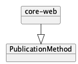
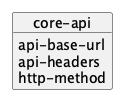
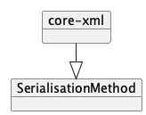

# CPRMV API

## core-json (method module)

The core.json method is a serialisation method that serves as a basis for the support of JSON serialisations of RuleSet's for any RuleMethod that typically use JSON as a serialisation format.

The roo method is an example of such

This serialisation method is defined for support within API's that serve CPRMV metadated publications of which the CPRMV API is a reference implementation and should not be used directly and therefor it is definied in the cprmv-serve namespace.

### <dfn>core.json</dfn>
 CPRMV API - Generic JSON Serialisation  Method

subclass of: [https://cprmv.open-regels.nl/0.4.4/methods/module](https://cprmv.open-regels.nl/0.4.4/methods/module)

subclass of: <a>SerialisationMethod</a>

<figure id='concepts'><figcaption>class diagram core.json</figcaption></figure>
properties:

| Property | Type/Range | Cardinality | Definition |
| --- | --- | --- | --- |

## core-web (method module)

The core.web method is a publication method that serves as a basis for the support retrieval of RuleSet's that have been published and are retrieveable through HTTP.

The operaton and frbr-sru methods are examples of such.

This serialisation method is defined for support within API's that serve CPRMV metadated publications of which the CPRMV API is a reference implementation and should not be used directly and therefor it is definied in the cprmv-serve namespace.

### <dfn>core.web</dfn>
 CPRMV API - Generic Web Publication Method

subclass of: [https://cprmv.open-regels.nl/0.4.4/methods/module](https://cprmv.open-regels.nl/0.4.4/methods/module)

subclass of: <a>PublicationMethod</a>

<figure id='concepts'><figcaption>class diagram core.web</figcaption></figure>
properties:

| Property | Type/Range | Cardinality | Definition |
| --- | --- | --- | --- |
| repository-publication-location-format |   | 0..1 | The format of the URL to retrieve a publication |

## core-api (method module)

The core.api method is a publication method that serves as a basis for the support retrieval of RuleSet's that have been published and are retrieveable through an REST API.
As such it is based on the core.web method.  

The roo and dso methods are examples of such.

This publication method is defined for support within API's that serve CPRMV metadated publications of which the CPRMV API is a reference implementation and should not be used directly and therefor it is definied in the cprmv-serve namespace.

### <dfn>core.api</dfn>
 CPRMV API - Generic API Publication Method

subclass of: [https://cprmv.open-regels.nl/0.4.4/methods/module](https://cprmv.open-regels.nl/0.4.4/methods/module)

subclass of: <a>core-web</a>

<figure id='concepts'><figcaption>class diagram core.api</figcaption></figure>
properties:

| Property | Type/Range | Cardinality | Definition |
| --- | --- | --- | --- |
| api-base-url |   | 0..1 | The base URL of the API |
| api-headers |   | 0..1 | The headers to use in requests to the API |
| HTTP method |   | 0..1 | The HTTP method with which to access the API. (default=GET) |

## core-xml (method module)

The core.xml method is a serialisation method that serves as a basis for the support of XML serialisations of RuleSet's for any RuleMethod that typically use XML as a serialisation format.

The fmx4 method is an example of such.

This serialisation method is defined for support within API's that serve CPRMV metadated publications of which the CPRMV API is a reference implementation and should not be used directly and therefor it is definied in the cprmv-serve namespace.

### <dfn>core.xml</dfn>
 CPRMV API - Generic XML Serialisation  Method

subclass of: [https://cprmv.open-regels.nl/0.4.4/methods/module](https://cprmv.open-regels.nl/0.4.4/methods/module)

subclass of: <a>SerialisationMethod</a>

<figure id='concepts'><figcaption>class diagram core.xml</figcaption></figure>
properties:

| Property | Type/Range | Cardinality | Definition |
| --- | --- | --- | --- |
| xslt |   | 0..1 | The name of the XSLT file to apply to transform the raw XML publication into RDF for use within the CPRMV API |

