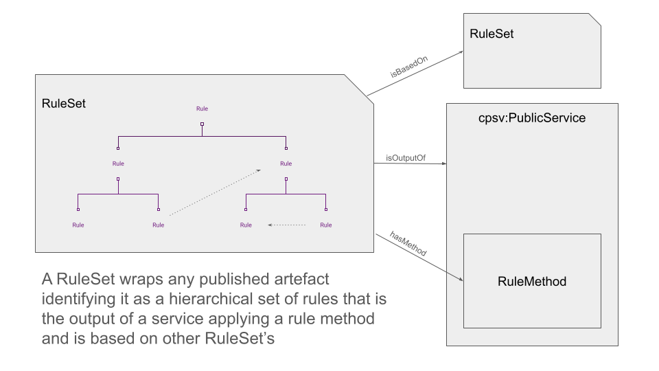
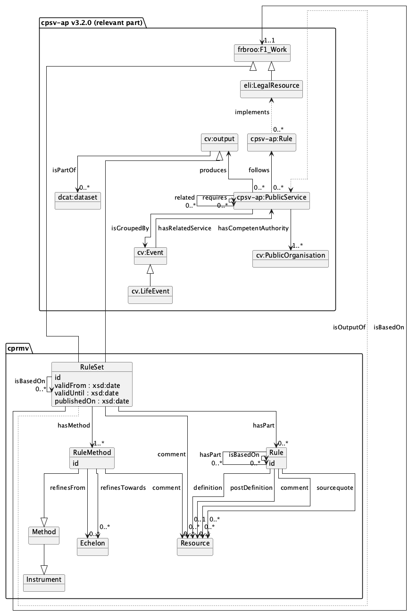
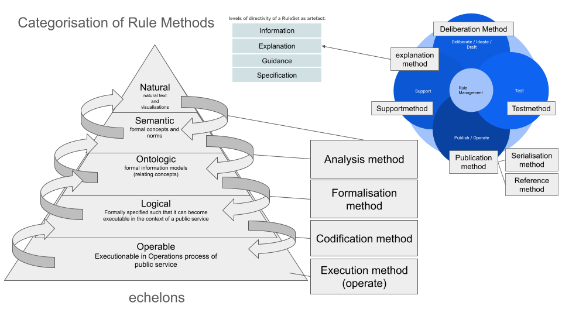

# Non normative section

## Introduction: Managing rules is part of service delivery 

Transparancy and accountability are two core values of public administration. As such, the [[[CPSV-AP]]] contains the notion of public services (cpsv:PublicService) following rules (cpsv:Rule) that implement legal resources (eli:LegalResource). Detailed modelling of rules is out of scope of [[[CPSV-AP]]] as is stated in the documentation regarding the cpsv:Rule concept. [[[CPSV-AP]]] also doesn’t describe how those rules and legal resources are created in the first place.

A key notion of the rule of law is that the creation of rules is itself subject to the law. As such, the creation of legal resources and rules can be considered (part of) a public service being delivered. From a transparency and accountability perspective, you then even can consider the creation of any artefact needed to transform law into executable public services to be (part of) a public service, for example (but not limited to): the creation of legislation, policy documents, instructions, explanations, data models, process models, rule models, system design, etc. Even the decisions that are output of a public service that follows the rules can be seen as such artefacts. 

Such artefacts are not just information, but contain the output of a public service, that often has the status of being denoted as what has been decided upon, what is specified, and what (other) public services will follow from that moment. In the legal domain this is what is called "positive law" (not as in positive versus negative but as in that what has been posited) which is subject to the so called "rule of recognition". All these specification artefacts, not only the ones in the legal domain, then can be seen as sets of rules. A rule being knowledge that is published as what has been decided upon and other rules can get and typically are based on, entirely independent of specific domains and disciplines.

To maximally support transparency, collaboration and efficiency, feeding back into quality of rules and the services that follow them, this knowledge should be published in public and findable for whomever it may concern as far it is not traceable to personal information. Almost always, in the end this means any person must be able to find this information while in practice a lot of it is not. This information not only includes the specification artefacts themselves but also it's provenance metadata. As part of what service of what organisation such specification artefacts are created as the output of what kind of activity following what kind of method, standards and tools, is all part of this information which is currently often hard to find and get an overview of while necessary for effective support processes and trust.

For this, first of all the [[[CPRMV]]] introduces the concept of a Ruleset, being a set of (nested) Rule's. A Ruleset bundles one or more specification artefacts, as the output of a public service and the result of a deliberation process within the context of the delivery of a service. A ruleset describes these specification artefacts as sets of Rule's, exactly as how they are created by the public service, and puts these into the RuleSet which can be seen as an envelope. As such, it abstracts from the structure, format and meaning of these specification artefacts which heavily depend on the great number of instruments, being methods, standards and tools, involved in rule management. 

[[[CPRMV]]] is strongly tied to and to be seen an extension of [[[CPSV-AP]]] and designed to meet the following use-cases:

-	Describing the output of a public service as a Ruleset;
-	Bundle any specification artefact, seen as sets of Rule's themselves into an identifiable Ruleset of identifiable Rule's;
-	Providing information about what is needed to interpret the bundled specification artefacts in the RuleSet;
-	Facilitate referencing specific Rules in specification artefacts bundled within a Ruleset
-	Facilitate links between rulesets and rules within rulesets.

Rules should not be created as in a waterfall model, but are created initially based on existing knowledge, followed in service delivery and supported feeding back into incident management and a change and continuous improvement process involving many organisations as stakeholders. All these processes already sometimes do, can and otherwise maybe should involve citizens as an end user in some direct or indirect way. Facilitating that is also public service delivery itself.

## Conceptual overview

A core overview of only the most important concepts in [[[CPRMV]]] is shown below. Everything else in [[[CPRMV]]] enfolds from this core insight. RuleSet's are sets of possibly nested Rule's in a hierarchical (tree) structure that are created and managed within public services by applying RuleMethod's for which they are denoted as (part of the) ouput of. They can be based on other RuleSets.

<figure id="concepts">
  
  <figcaption>CPRMV main concepts</figcaption>
</figure>

All concepts in relation to the [[[CPRMV]]] are defined in the normative sections hereafter. This section gives a non normative main overview of the concepts of the [[[CPRMV]]].

The following class diagram overview shows the main [[[CPRMV]]] concepts in relation to each other
and how they relate to the [[[CPSV-AP]]] (version 3.2.0). Note that the overview does not include the entire [[[CPSV-AP]]], only a relevant part. The overview does still also only include a selection of all concepts within the [[[CPRMV]]]. 

<figure id="concepts">
  
  <figcaption>CPRMV main concepts</figcaption>
</figure>

## Echelons and Instruments

When creating rules within the context of a public service, Instruments are used. Instruments being either methods, standards or tools. When looked at a public service from a government wide perspective, rules initially are always elicitated in Natural Language (or visuals) in generic terms and then get more elaborated using instruments in steps typically involving several public services develivered by several public organisations, all the way to more directly operable forms of rules. Even decisions that are made based on rules are automatically related to all this. As these decisions form evidence, also all data involved relates to rules. The creation, usage and maintenance of all these rules forms an iterative design process. The CPRMV categorizes Ruleset's and the instruments to manage them to be related to specific so called Echelons, a concept borrowed from design science (), that can be distinguished in this government wide design process without enforcing any design method. In general the following Echelons can be distinguished as such:

1. Natural Echelon : Rules are denoted in the form of natural language or visuals agreed upon. 
2. Semantical Echelon : Rules that also formalise the concepts (What is) and norms (What needs to be) that are identified in official natural language descriptions of rules.
3. Ontological Echelon : Rules that also formalise relations between formalised concepts and norms into information models.
4. Logical Echelon : Rules that elaborate on information models to the point they are operable, like process and decision models. Rules tied to this Echelon are still not necesarily tied to be followed in a specific public service of a specific organisation and can be reusable.
5. Operable Echelon : The operable rules that are actually followed in the primary operational process of a specific public service being delivered by a specific organisation.
6. Support Echelon : Rules related to support processes. Support for the rules themselves or the output of public services based on these rules. 

Instruments are used to create these types of rulesets, based on rulesets that fall into the same or a different Echelon. An instrument therefor helps refining rulesets from and towards Echelons and for any ruleset the creation of another ruleset is based on, a ruleset first has to be published in some way such that they can be referenced and found in some type of rule registry related to a services register and organisation register. Regardless of the Echelon to which an instrument is tied with which rules in a ruleset are created, a ruleset can also be tested in some way using instruments for testing and sets of testcases are rulesets themselves. Also, any artefact typically gets explained in explanatory artefacts. For this, the [[[CPRMV]]] defines additional Echelons relating to publishing, testing and explaining specification artefacts and which have their own specific related instruments and artefacts. A standard and a tool is always related to a method. And several generic methods relating to the Echelons can be distinguished. This results in the following relations between generic methods (cprmv:RuleMethod) and echelons the [[[CPRMV]]] defines:

<figure id="concepts">
  
  <figcaption>CPRMV Echelons and Instruments</figcaption>
</figure>

A great number of people working in specific disciplines in specific domains work on rules using a great number of instruments already. To make all this accessible for each other, [[[CPRMV]]] additionaly defines a governed value list of specific rule methods known and acknowledged to be in use somewhere within service delivery within the EU. A current overview of this is given in chapter 4.
