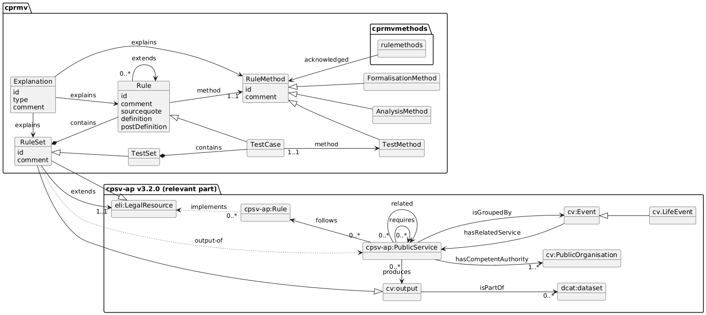

## Conceptual overview

All concepts in relation to the [[[CPRMV]]] are defined in the normative sections hereafter. This section gives a non normative overview of the concepts of the [[[CPRMV]]].

The following overview shows the main [[[CPRMV]]] concepts in relation to each other
and how they relate to the [[[CPSV-AP]]] (version 3.2.0). Note that the overview does not include the entire [[[CPSV-AP]]], only a relevant part. The overview does include the entire [[[[CPRMV]]]. 

<figure id="concepts">
  
  <figcaption>CPRMV concepts</figcaption>
</figure>

### Rules structured in RuleSets as legal resources

Where the CPSV-AP associates a service with zero to many Rules (the Rule concept in the CPSV-AP), stating the service "follows" these Rules, and such a Rule implements a Legal Resource ([[[ELI]]]) which can be related to many other Legal Resources, the CPRMV denotes Legal Resources to be formalised by a single RuleSet, that are sets of Rules (the Rule concept in the CPRMV) that together "implement" (formalises) the related Legal Resource to a certain extent. 

Where two Legal Resources relate, also the RuleSets that implement these Legal Resources will relate in the same way to each other. Rules may however refer to specific concepts within other Rules in the same or related RuleSets though by design only in a certain limited way.

Moreover, a RuleSet is to be seen and published as a Legal Resource too which can be formalised even further through a single other RuleSet. 

When using the CPRMV, a Service (CPSV-AP) can implicitly follow the Rules from a single RuleSet, and therefor all the Rules a service follows refer to the same legal resource that is the most specific legally binding agreement that defines the service. Such legal resources currently are often not defined and published as such.

### Rule Methods

The CPRMV allows for specifying the method with which Rules in a RuleSet are implemented. There are four general types of such RuleMethods for formalising agreements: Analysis Methods, Formalisation Methods, Codification Methods and Test Methods.

Analysis Methods do not yet entirely formalize knowledge in a legal resource such that you get rules that can be seen as deterministic enough for use in the operationalisation of services that then need to be able to follow these rules. Typically these methods involve annotating legal resources, structured as a set of rules with expert knowledge towards full formalisation.

Formalisation Methods are methods for interpretation of knowledge, describing them as rules in a way that make them suitable and interoperable enough for operationalisation by systems that conform to the [[CPRMV]] within the processes with which a Public Service is delivered..

Codification Methods are methods for transforming formalised rules into a code language that can be executed by specific systems within the processes with which a Public Service is delivered. 

Note that services may be defined in which these methods are applied by multidisciplinary expert teams who are guided by these services. These teams will consist of representatives from different disciplines of the competent authority organisations that also specify the legal agreements and publish them as resource that impact the services that follow the rules in the rulesets that implement these legal resources. These services do operationalize on rules as goal artifacts and probably can consume them for that goal. In such services, a RuleSet is the Ouput of the service in terms of the [[[CPSV-AP]]]. This makes all Rules, even those only containing the extra knowledge through applying Analysis Methods machine consumable, not to be mistaken for machine executable. 

Typically, RuleMethods also allow for testing Rules using test datasets which contain testcases (sometimes also called test scenario's). Just like the Rule concept in the [[[CPRMV]]], a test case only add extra very specific rules to rules to see, whether all the rules together including the extra ones of the test case still hold or not. Therefor a dataset with test cases, a TestSet, is a RuleSet that contains one or more TestCase's which are Rule's themselves. TestCases are developed and evaluated through Test Methods which is a fourth kind of a RuleMethod.

The standard for Public Rule Management the CPRMV is part of also includes a governed list of acknowledged Rule Methods. RuleMethods may include many things, including a prescribed way of utilizing the RuleMethod, or using prescribed tooling etcetera. Besides the obvious well known RuleMethods related to established Business Rule Management methods with related standards and tooling such as SBVR, DMN, some localised adoption of RuleSpeak, OpenFisca, Law Analysis (Wetsanalyse), Calculemus/FLINT and so on, also standards for describing architecture such as Archimate could actually be seen as a RuleMethod, or in the future maybe even methods utilising Universal Meaning Representations with some new type of AI that then probably will have to need to include symbolic AI reasoners to become reliable enough. Even this very document, the CPRMV vocabulary can be formalized as a RuleSet conforming to itself and becoming a potential standard as a legal resource that other Rules in other RuleSets can refer to.

Allowing all these kinds of RuleMethods mixed together does not fully solve interoperability on its own, but it allows for getting all information already put into practice yet kept hidden, published openly from which point it is more easy to get to see how things correlate and to collaborate on traceability, explainability and interoperability resulting in more transparency, trust and efficiency. This is an important first step. All Rules express knowledge that needs to be known and explainable. Rules expressing the same knowledge with different RuleMethods that formalize to a comparable extent, should actually not differ that much semantically, and it should be fairly possible to work on rule interchange once the benefits of public rule management become clear. The more RuleMethods are in use, the more systems will need to be able to support them all. To enforce a single RuleMethod at current times is unrealistic however and probably not favorable in the future too, as none single RuleMethod will suffice for all in all cases. It will however become evident where stacking different interpretation steps using different methods on top of each other will only increase riscs and work if not part of a methodological approach.

### Traceability and Explainability

All Rules must cite and/or refer to their specific sources they form an analyis/formalization of. This can be done through a AnalysisMethod that just chunks a legal resource in identifiable Rules and subparts, citing the legal resources that often are crafted in natural language and published as such.

Rules refer to explanations where possible, for any specific stakeholder group requiring specific explanation of the Rule on its own (context independent), given a certain natural language and level of language that matches the group of stakeholders as intended audience. Note that these explanations may also contain parts of explanations in a way such that context dependent (personalized) explanations can be made by services that operationalize on rules. It depends on the type of an Explanation object what content to expect. The CPRMV does not prescribe anything for this yet.

The idea not to rely on services utilizing machines to generate explanations on formalized rules (without explanatory content) in its entirety is to have more unification and deliberation on how rules are to be explained to (and therefor interpreted by) any stakeholder). Automation of explanatory content based on Rules is possible but resembles the possibility of automation of formalisation of Rules from legal resources in natural language both of which will always need human oversight before and during services that operationalize on them. Also, automation requires all agreements to be available in a machine consumable form which currenlty seems not to be the case for details in the interpretation of agreements that are published and for example policies for edge cases solved only locally in an ad hoc way.

These Explanations are also to be defined at the level of a whole RuleSet (which can specify a public service). Again, these may be automaticly generated through the explanations of the rules in the ruleset, but not entirely and without proper human oversight.

### Transparency - Open Government 

The CPRMV is part of a standard for public rule management that will guide organisations to publish their RuleSet's (bundled sets of Rules) as legal resources in relation to the legal resources they implement.

### Extendability

Note that it might be persuasive to extend this vocabulary with metadata on the operationalisation of sercices that follow the rules. Where this metadata has its origin in some specific Rule or legal resource it cites or refers to this might be plausible but then it might be best to introduce a RuleMethod for formalising the metadata at that level. Where the metadata is not dependent on Rules or Legal Resources (not affecting the outcome of a service), or form explanations, it is better not to include this in RuleSets. This kind of metadata might however be bundled with RuleSets and the explanatory content in relation to the same legal resources too to keep all relevant things together in relation to services.
