# CPRMV Specification

### <dfn>Instrument</dfn>
 An instrument is something that is used in relation to rules. For instance a method, standard or tool

<figure id='concepts'>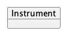<figcaption>class diagram Instrument</figcaption></figure>
properties:

| Property | Type/Range | Cardinality | Definition |
| --- | --- | --- | --- |

### <dfn>Standard</dfn>
 Denotes a standard that is used in relation to rules as an instrument.

subclass of: <a>Instrument</a>

<figure id='concepts'>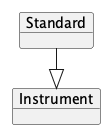<figcaption>class diagram Standard</figcaption></figure>
properties:

| Property | Type/Range | Cardinality | Definition |
| --- | --- | --- | --- |

### <dfn>Tool</dfn>
 Denotes a tool that is used in relation to rules as an instrument.

subclass of: <a>Instrument</a>

<figure id='concepts'>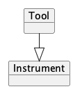<figcaption>class diagram Tool</figcaption></figure>
properties:

| Property | Type/Range | Cardinality | Definition |
| --- | --- | --- | --- |

### <dfn>Method</dfn>
 Denotes a method that is used in relation to rules as an instrument.

subclass of: <a>Instrument</a>

<figure id='concepts'><figcaption>class diagram Tool</figcaption></figure>
properties:

| Property | Type/Range | Cardinality | Definition |
| --- | --- | --- | --- |

### <dfn>RuleSet</dfn>
 A bundle of specifying artefacts (being cprmv:Rule's) agreed upon as the output of a deliberation process within the service delivery of a cpsv:Publicservice. Also when combined with the CPSV-AP, being a cv:Output, a cprmv:RuleSet cprmv:is_part_of a dcat.Dataset. 

subclass of: [http://purl.org/vocab/frbr/coreEndeavor](http://purl.org/vocab/frbr/coreEndeavor)

subclass of: [http://data.europa.eu/m8g/Output](http://data.europa.eu/m8g/Output)

subclass of: [http://www.w3.org/ns/prov#Bundle](http://www.w3.org/ns/prov#Bundle)

<figure id='concepts'>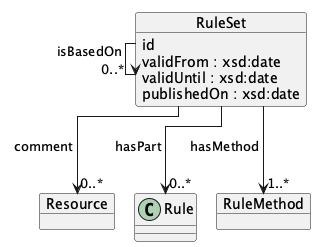<figcaption>class diagram RuleSet</figcaption></figure>
properties:

| Property | Type/Range | Cardinality | Definition |
| --- | --- | --- | --- |
| id |   | 1..1 | denotes a universal unique id with which to refer to what the cprmv object like RuleMethod's Explanation's, RuleSet's and Rule's represents. |
| isBasedOn |  RuleSet | 0..* | In the case of a RuleSet this property states the RuleSet to be derived from the RuleSet(s) in their entirety (all cprmv:Rules contained in the cprmv:RuleSet that is derived from, depending on whether they are defined with the same cprmv:hasMethod or not, can or must have matching ones in the cprmv:RuleSet that derives) possibly aggregated by analysis or formalisation (not codification). In the case of a cprmv:Rule it refers to the matching cprmv:Rule contained in a cprmv:RuleSet that is derived from by the RuleSet that contains the deriving cprmv:Rule (this must be the case). A cprmv:Rule in the cprmv:RuleSet that is derived from does not have to be referred by a cprmv:Rule contained in the deriving cprmv:RuleSet if both RuleSet's contain only cprmv:Rule's defined with the same cprmv:method, in which case this implies the cprmv:Rule implicitly becomes part of the deriving cprmv:RuleSet as is. Multiple cprmv:Rule's / cprmv:RuleSet's can be derived from within the same cprmv:Rule / cprmv:RuleSet |
| isOutputOf |  http://purl.org/vocab/cpsv#PublicService | 1..* | denotes a cprmv:RuleSet to be produced as cv:Ouput of a cpsv:PublicService |
| method |  RuleMethod | 1..* | denotes the cprmv:RuleMethod used to define the cprmv:RuleSet |
| validFrom | xsd:date | 1..1 | denotes the date from which day on the RuleSet is to be held valid. |
| validUntil | xsd:date | 0..1 | denotes the date until which day on the RuleSet is to be held valid. On the day of this date, the RuleSet is no longer valid. If no date value is set, this means the RuleSet is valid until further notice. |
| publishedOn | xsd:date | 0..1 | denotes the date at which day the RuleSet has been officially published. Note that the RuleSet may denote to be valid from a date before this date of publishing. |
| hasPart |   | 0..1 | denotes the ordered list of Rule's as the parts a Rule(Set) can have and together with the cprmv:definition and cprmv:postDefinition properties (in case of Rule's') define the Rule(Set) by concatenating the definition, the definitions of the cprmv:Rule's that are part of it (recursively in order) and their postDefinition's |
| comment |  http://www.w3.org/2000/01/rdf-schema#Resource | 0..* | denotes information as comment for a cprmv:Rule, cprmv:RuleSet or cprmv:RuleMethod |

### <dfn>Analysis</dfn>
 A Rule Set that has been produced by following a Analysis Method.

subclass of: <a>RuleSet</a>

<figure id='concepts'>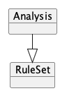<figcaption>class diagram Analysis</figcaption></figure>
properties:

| Property | Type/Range | Cardinality | Definition |
| --- | --- | --- | --- |

### <dfn>DecisionModel</dfn>
 A Rule Set that has been produced by following a Formalisation Method.

subclass of: <a>RuleSet</a>

<figure id='concepts'>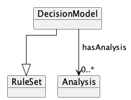<figcaption>class diagram DecisionModel</figcaption></figure>
properties:

| Property | Type/Range | Cardinality | Definition |
| --- | --- | --- | --- |
| hasAnalysis |  Analysis | 0..* | denotes the Analysis a DecisionModel is based on. |

### <dfn>Rule</dfn>
 A Rule denotes a part of a specification artifact agreed upon as the output of a deliberation process in the context of service delivery which can be expressed in many forms for instance in the form of natural language like articles in laws as well as more formal business rules for automation of decisions.

subclass of: [http://www.w3.org/ns/prov#Entity](http://www.w3.org/ns/prov#Entity)

<figure id='concepts'>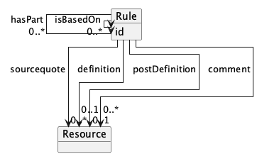<figcaption>class diagram Rule</figcaption></figure>
properties:

| Property | Type/Range | Cardinality | Definition |
| --- | --- | --- | --- |
| id |   | 1..1 | denotes a universal unique id with which to refer to what the cprmv object like RuleMethod's Explanation's, RuleSet's and Rule's represents. |
| isBasedOn |  Rule | 0..* | In the case of a RuleSet this property states the RuleSet to be derived from the RuleSet(s) in their entirety (all cprmv:Rules contained in the cprmv:RuleSet that is derived from, depending on whether they are defined with the same cprmv:hasMethod or not, can or must have matching ones in the cprmv:RuleSet that derives) possibly aggregated by analysis or formalisation (not codification). In the case of a cprmv:Rule it refers to the matching cprmv:Rule contained in a cprmv:RuleSet that is derived from by the RuleSet that contains the deriving cprmv:Rule (this must be the case). A cprmv:Rule in the cprmv:RuleSet that is derived from does not have to be referred by a cprmv:Rule contained in the deriving cprmv:RuleSet if both RuleSet's contain only cprmv:Rule's defined with the same cprmv:method, in which case this implies the cprmv:Rule implicitly becomes part of the deriving cprmv:RuleSet as is. Multiple cprmv:Rule's / cprmv:RuleSet's can be derived from within the same cprmv:Rule / cprmv:RuleSet |
| hasPart |   | 0..1 | denotes the ordered list of Rule's as the parts a Rule(Set) can have and together with the cprmv:definition and cprmv:postDefinition properties (in case of Rule's') define the Rule(Set) by concatenating the definition, the definitions of the cprmv:Rule's that are part of it (recursively in order) and their postDefinition's |
| definition |  http://www.w3.org/2000/01/rdf-schema#Resource | 0..1 | denotes the head part of the definition of a cprmv:Rule which is either a rdfs:text or any representation of knowledge in the form of rdf |
| postDefinition |  http://www.w3.org/2000/01/rdf-schema#Resource | 0..1 | denotes the tail part of the definition of a cprmv:Rule which is either a rdfs:text or any representation of knowledge in the form of rdf. This property is only to be used when there are one or more cprmv:Rule's contained by the cprmv:Rule this property belongs to |
| comment |  http://www.w3.org/2000/01/rdf-schema#Resource | 0..* | denotes information as comment for a cprmv:Rule, cprmv:RuleSet or cprmv:RuleMethod |
| source quote |  http://www.w3.org/2000/01/rdf-schema#Resource | 0..* | replicates (a part of) the definition of the cprmv:Rule that is being extended |

### <dfn>Parameter</dfn>
 A Rule that forms a parameter. Normally these are specific small parts of a Rule Set that are changed more often than the rest of a Rule Set. They normally have a definition holding information that is of a simple type like a number, date etc.

subclass of: <a>Rule</a>

<figure id='concepts'>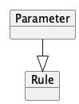<figcaption>class diagram Parameter</figcaption></figure>
properties:

| Property | Type/Range | Cardinality | Definition |
| --- | --- | --- | --- |

### <dfn>RuleMethod</dfn>
 A Rule Method is a acknowledged known method as an instrument for defining Rule's, either from scratch through deliberation and / or based on existing Rule's.

subclass of: <a>Tool</a>

<figure id='concepts'>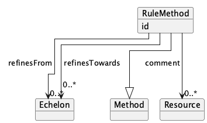<figcaption>class diagram RuleMethod</figcaption></figure>
properties:

| Property | Type/Range | Cardinality | Definition |
| --- | --- | --- | --- |
| id |   | 1..1 | denotes a universal unique id with which to refer to what the cprmv object like RuleMethod's Explanation's, RuleSet's and Rule's represents. |
| comment |  http://www.w3.org/2000/01/rdf-schema#Resource | 0..* | denotes information as comment for a cprmv:Rule, cprmv:RuleSet or cprmv:RuleMethod |
| refinesTowards |  echelon | 0..* | Denotes the Echelon a RuleMethod refines RuleSets towards. |
| refinesFrom |  echelon | 0..* | Denotes the Echelon a RuleMethod refines RuleSets from. |

### <dfn>AnalysisMethod</dfn>
 A Rule Method with which an existing Rule is extended through analysis, which does not yet entirely formalises a Rule semantically but only defines what is to be seen as a separate Rule and adds metadata to it or normalises its form etcetera.

subclass of: <a>RuleMethod</a>

<figure id='concepts'>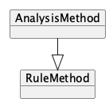<figcaption>class diagram AnalysisMethod</figcaption></figure>
properties:

| Property | Type/Range | Cardinality | Definition |
| --- | --- | --- | --- |
| refinesTowards |  OntologicEchelon, SemanticEchelon, NaturalEchelon | 0..* | Denotes the Echelon a RuleMethod refines RuleSets towards. |
| refinesFrom |  OntologicEchelon, SemanticEchelon, NaturalEchelon | 0..* | Denotes the Echelon a RuleMethod refines RuleSets from. |

### <dfn>FormalisationMethod</dfn>
 A Rule Method with which an existing Rule is extended through formalisation, which entirely formalises a Rule semantically as far as possible and makes it represented in a interoperable way to the point cprmv compatible systems can comsume them within processes for delivering Public Services.

subclass of: <a>RuleMethod</a>

<figure id='concepts'>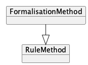<figcaption>class diagram FormalisationMethod</figcaption></figure>
properties:

| Property | Type/Range | Cardinality | Definition |
| --- | --- | --- | --- |
| refinesTowards |  OperableEchelon, LogicEchelon | 0..* | Denotes the Echelon a RuleMethod refines RuleSets towards. |
| refinesFrom |  LogicEchelon, OntologicEchelon, SemanticEchelon, NaturalEchelon | 0..* | Denotes the Echelon a RuleMethod refines RuleSets from. |

### <dfn>SerialisationMethod</dfn>
 A meta Rule Method with which an existing Rule is serialised as a textual file that can be stored. Think about XML, JSON, YAML, Turtle as common ways to do this.

subclass of: <a>RuleMethod</a>

<figure id='concepts'>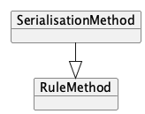<figcaption>class diagram SerialisationMethod</figcaption></figure>
properties:

| Property | Type/Range | Cardinality | Definition |
| --- | --- | --- | --- |

### <dfn>CodificationMethod</dfn>
 A Rule Method with which an existing Rule is extended through codification, which entirely formalises a Rule semantically if necesary as well as codifies them into an executable form that can be utilised by specific systems within processes for delivering Public Services.

subclass of: <a>RuleMethod</a>

<figure id='concepts'>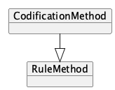<figcaption>class diagram CodificationMethod</figcaption></figure>
properties:

| Property | Type/Range | Cardinality | Definition |
| --- | --- | --- | --- |
| refinesTowards |  OperableEchelon | 0..* | Denotes the Echelon a RuleMethod refines RuleSets towards. |
| refinesFrom |  LogicEchelon, OntologicEchelon, SemanticEchelon, NaturalEchelon | 0..* | Denotes the Echelon a RuleMethod refines RuleSets from. |

### <dfn>ExecutionMethod</dfn>
 A Rule Method with which an existing Rule is executed in the context of delivering a Public Service.

subclass of: <a>RuleMethod</a>

<figure id='concepts'><figcaption>class diagram ExecutionMethod</figcaption></figure>
properties:

| Property | Type/Range | Cardinality | Definition |
| --- | --- | --- | --- |
| refinesTowards |  OperableEchelon | 0..* | Denotes the Echelon a RuleMethod refines RuleSets towards. |
| refinesFrom |  OperableEchelon, LogicEchelon, NaturalEchelon | 0..* | Denotes the Echelon a RuleMethod refines RuleSets from. |

### <dfn>ExplanationMethod</dfn>
 An explanation method defines the method for producing Explanations in relation to cprmv:Rule(Set)'s'

subclass of: <a>RuleMethod</a>

<figure id='concepts'><figcaption>class diagram ExplanationMethod</figcaption></figure>
properties:

| Property | Type/Range | Cardinality | Definition |
| --- | --- | --- | --- |
| refinesTowards |  OperableEchelon | 0..* | Denotes the Echelon a RuleMethod refines RuleSets towards. |
| refinesFrom |  OperableEchelon, LogicEchelon, OntologicEchelon, SemanticEchelon, NaturalEchelon | 0..* | Denotes the Echelon a RuleMethod refines RuleSets from. |

### <dfn>TestMethod</dfn>
 A Rule Method with which Rule's are defined that describe test scenario's defined in cprmv:TestSet's containing cprmv:TestCase's, which are specialised cprmv:RuleSet's and cprmv:Rule's and that can be tested in the context of a cprmv:RuleSet's.

subclass of: <a>RuleMethod</a>

<figure id='concepts'>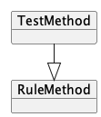<figcaption>class diagram TestMethod</figcaption></figure>
properties:

| Property | Type/Range | Cardinality | Definition |
| --- | --- | --- | --- |
| refinesTowards |  SupportEchelon | 0..* | Denotes the Echelon a RuleMethod refines RuleSets towards. |
| refinesFrom |  OperableEchelon | 0..* | Denotes the Echelon a RuleMethod refines RuleSets from. |

### <dfn>PublicationMethod</dfn>
 A Rule Method for publication of the definition of Rule(Set)'s apart from the Execution of them...

subclass of: <a>RuleMethod</a>

<figure id='concepts'>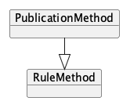<figcaption>class diagram PublicationMethod</figcaption></figure>
properties:

| Property | Type/Range | Cardinality | Definition |
| --- | --- | --- | --- |
| refinesTowards |  OperableEchelon | 0..* | Denotes the Echelon a RuleMethod refines RuleSets towards. |
| refinesFrom |  OperableEchelon, LogicEchelon, OntologicEchelon, SemanticEchelon, NaturalEchelon | 0..* | Denotes the Echelon a RuleMethod refines RuleSets from. |

### <dfn>OrganisationRegister</dfn>
 A Rule Method for publication of a catalog of organisations thet produce RuleSet's as part of their service delivery.

subclass of: <a>PublicationMethod</a>

<figure id='concepts'>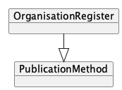<figcaption>class diagram OrganisationRegister</figcaption></figure>
properties:

| Property | Type/Range | Cardinality | Definition |
| --- | --- | --- | --- |

### <dfn>AcknowledgedOrganisation</dfn>
 A Rule denoting the official acknowledgement of an organisation (cv:PublicOrganisation) that produce RuleSet's as part of their service delivery.

subclass of: <a>Rule</a>

<figure id='concepts'>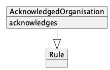<figcaption>class diagram AcknowledgedOrganisation</figcaption></figure>
properties:

| Property | Type/Range | Cardinality | Definition |
| --- | --- | --- | --- |
| acknowledges |   | 0..1 | Denotes the CPSV-AP:PublicOrganisation / CV:PublicService an AcknowledgedOrganisation / AcknowledgedService acknowledges as a Rule |

### <dfn>OrganisationCatalog</dfn>
 A RuleSet that forms a catalog of officially acknowledged organisations (cv:PublicOrganisation) that produce RuleSet's as part of their service delivery.

subclass of: <a>RuleSet</a>

<figure id='concepts'>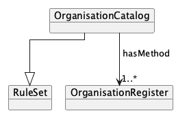<figcaption>class diagram OrganisationCatalog</figcaption></figure>
properties:

| Property | Type/Range | Cardinality | Definition |
| --- | --- | --- | --- |
| method |  OrganisationRegister | 1..* | denotes the cprmv:RuleMethod used to define the cprmv:RuleSet |

### <dfn>ServiceRegister</dfn>
 A Rule Method for publication of a catalog of services (CPSV-AP:PublicService) in which RuleSet's are produced. There is none that does not.

subclass of: <a>PublicationMethod</a>

<figure id='concepts'>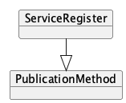<figcaption>class diagram ServiceRegister</figcaption></figure>
properties:

| Property | Type/Range | Cardinality | Definition |
| --- | --- | --- | --- |

### <dfn>AcknowledgedService</dfn>
 A Rule denoting the official acknowledgement of a service (CPSV-AP:PublicService) in which RuleSet's are produced.

subclass of: <a>Rule</a>

<figure id='concepts'>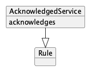<figcaption>class diagram AcknowledgedService</figcaption></figure>
properties:

| Property | Type/Range | Cardinality | Definition |
| --- | --- | --- | --- |
| acknowledges |   | 0..1 | Denotes the CPSV-AP:PublicOrganisation / CV:PublicService an AcknowledgedOrganisation / AcknowledgedService acknowledges as a Rule |

### <dfn>ServiceCatalog</dfn>
 A RuleSet that forms a catalog of officially acknowledged services (CPSV-AP:PublicService) in which RuleSet's are produced.

subclass of: <a>RuleSet</a>

<figure id='concepts'>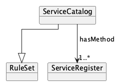<figcaption>class diagram ServiceCatalog</figcaption></figure>
properties:

| Property | Type/Range | Cardinality | Definition |
| --- | --- | --- | --- |
| method |  ServiceRegister | 1..* | denotes the cprmv:RuleMethod used to define the cprmv:RuleSet |

### <dfn>ReferenceMethod</dfn>
 A meta Rule Method for the referencing of Rule(Set)'s apart from the operationalisation of them...

subclass of: <a>PublicationMethod</a>

<figure id='concepts'>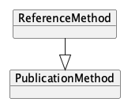<figcaption>class diagram ReferenceMethod</figcaption></figure>
properties:

| Property | Type/Range | Cardinality | Definition |
| --- | --- | --- | --- |

### <dfn>Explanation</dfn>
 A cprmv:Explanation is a cprmv:Rule defined with a cprmv:ExplanationMethod. This Rule contains a concise explanation of one or multiple Rule's or RuleSet's.

subclass of: <a>Rule</a>

<figure id='concepts'>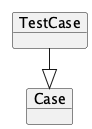<figcaption>class diagram TestCase</figcaption></figure>
properties:

| Property | Type/Range | Cardinality | Definition |
| --- | --- | --- | --- |
| explains |  RuleSet, Rule | 1..1 | denotes the cprmv:Rule(Set) a cprmv:Eplanation holds explanatory content of for the use of explaining them in the systems that use them for delivering Public Services |

### <dfn>TestCase</dfn>
 A TestCase is a cprmv:Case defined for and following a TestMethod

subclass of: <a>Case</a>

<figure id='concepts'><figcaption>class diagram TestCase</figcaption></figure>
properties:

| Property | Type/Range | Cardinality | Definition |
| --- | --- | --- | --- |

### <dfn>TestSet</dfn>
 A TestSet is a cprmv:RuleSet containing cprmv:TestCase's defined for following a TestMethod

subclass of: <a>RuleSet</a>

<figure id='concepts'>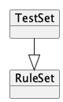<figcaption>class diagram TestSet</figcaption></figure>
properties:

| Property | Type/Range | Cardinality | Definition |
| --- | --- | --- | --- |

### <dfn>Decision</dfn>
 A Decision is a cprmv:Rule defined following a ExecutionMethod

subclass of: <a>Rule</a>

<figure id='concepts'>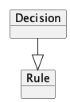<figcaption>class diagram Decision</figcaption></figure>
properties:

| Property | Type/Range | Cardinality | Definition |
| --- | --- | --- | --- |

### <dfn>Case</dfn>
 A Case is a cprmv:Rule containing a list of Decisions defined following a ExecutionMethod

subclass of: <a>Rule</a>

<figure id='concepts'>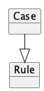<figcaption>class diagram Case</figcaption></figure>
properties:

| Property | Type/Range | Cardinality | Definition |
| --- | --- | --- | --- |

### <dfn>Echelon</dfn>
 An echelon is a category in which a RuleSet can be categorized in the context of service delivery, loosely based on the Theory of Hierarchical, Multilevel Systems (M. D. Mesarovic, D. Macko, Y. Takahara).

<figure id='concepts'><figcaption>class diagram echelon</figcaption></figure>
properties:

| Property | Type/Range | Cardinality | Definition |
| --- | --- | --- | --- |

### <dfn>NaturalEchelon</dfn>
 Echelon tied to the contract management process of a service based on USM in which solutions are designed as descriptions in natural language and it's grammar and/or visualisations.

subclass of: <a>echelon</a>

<figure id='concepts'>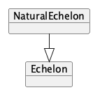<figcaption>class diagram NaturalEchelon</figcaption></figure>
properties:

| Property | Type/Range | Cardinality | Definition |
| --- | --- | --- | --- |

### <dfn>SemanticEchelon</dfn>
 Echelon tied to the contract management process of a service based on USM in which solutions are designed in terms of Concepts (What is) and Norms (What needs to be) based on descriptions in natural language.

subclass of: <a>echelon</a>

<figure id='concepts'><figcaption>class diagram SemanticEchelon</figcaption></figure>
properties:

| Property | Type/Range | Cardinality | Definition |
| --- | --- | --- | --- |

### <dfn>OntologicEchelon</dfn>
 Echelon tied to the contract management process of a service based on USM in which solutions are designed in terms of information models consisting of related to Concepts and Norms (defined within the context of the semantic echelon).

subclass of: <a>echelon</a>

<figure id='concepts'>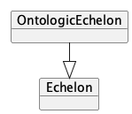<figcaption>class diagram OntologicEchelon</figcaption></figure>
properties:

| Property | Type/Range | Cardinality | Definition |
| --- | --- | --- | --- |

### <dfn>LogicEchelon</dfn>
 Echelon tied to the contract management process of a service based on USM in which solutions are designed in terms of logically formalised models such that they are operable, like decision and process models, based on related Concepts and Norms (defined within the context of the ontologic / semantic echelon).

subclass of: <a>echelon</a>

<figure id='concepts'>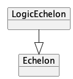<figcaption>class diagram LogicEchelon</figcaption></figure>
properties:

| Property | Type/Range | Cardinality | Definition |
| --- | --- | --- | --- |

### <dfn>OperableEchelon</dfn>
 Echelon tied to the operations process of a service based on USM in which operable solutions from echelons tied to the contract management process of a service based on USM are followed in service delivery.

subclass of: <a>echelon</a>

<figure id='concepts'>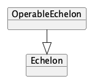<figcaption>class diagram OperableEchelon</figcaption></figure>
properties:

| Property | Type/Range | Cardinality | Definition |
| --- | --- | --- | --- |

### <dfn>SupportEchelon</dfn>
 Echelon tied to the three support processes of a service based on USM in which solutions are evaluated.

subclass of: <a>echelon</a>

<figure id='concepts'>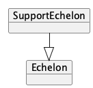<figcaption>class diagram SupportEchelon</figcaption></figure>
properties:

| Property | Type/Range | Cardinality | Definition |
| --- | --- | --- | --- |

