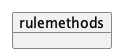
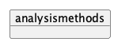
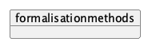
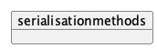
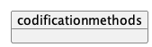
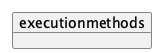
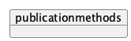
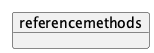

# CPRMV Methods

### <dfn>rulemethods</dfn>
 Value list of acknowledged rule methods.

<figure id='concepts'><figcaption>class diagram rulemethods</figcaption></figure>
properties:

| Property | Type/Range | Cardinality | Definition |
| --- | --- | --- | --- |
| acknowledged |   | 0..1 | a list with RuleMethod's that are acknowledged as part of the rule methods value list. |
| | | | <a>https://cprmv.open-regels.nl/0.4.3/serve-api/core-yaml</a> |
| | | | <a>https://cprmv.open-regels.nl/0.4.3/serve-api/core-xml</a> |
| | | | <a>https://cprmv.open-regels.nl/0.4.3/serve-api/core-api</a> |
| | | | <a>https://cprmv.open-regels.nl/0.4.3/serve-api/core-web</a> |
| | | | <a>https://cprmv.open-regels.nl/0.4.3/serve-api/core-python</a> |
| | | | <a>https://cprmv.open-regels.nl/0.4.3/serve-api/core-markdown</a> |
| | | | <a>https://cprmv.open-regels.nl/0.4.3/serve-api/core-json</a> |
| | | | <a>https://cprmv.open-regels.nl/0.4.3/methods/regalgo</a> |
| | | | <a>https://cprmv.open-regels.nl/0.4.3/methods/openfisca</a> |
| | | | <a>https://cprmv.open-regels.nl/0.4.3/methods/catala</a> |
| | | | <a>https://cprmv.open-regels.nl/0.4.3/methods/elinl</a> |
| | | | <a>https://cprmv.open-regels.nl/0.4.3/methods/elifmx4</a> |
| | | | <a>https://cprmv.open-regels.nl/0.4.3/methods/juriconnect</a> |
| | | | <a>https://cprmv.open-regels.nl/0.4.3/methods/cprmvapi</a> |
| | | | <a>https://cprmv.open-regels.nl/0.4.3/methods/regelrecht</a> |
| | | | <a>https://cprmv.open-regels.nl/0.4.3/methods/iou-operaton</a> |
| | | | <a>https://cprmv.open-regels.nl/0.4.3/methods/iou-norms</a> |
| | | | <a>https://cprmv.open-regels.nl/0.4.3/methods/roo-catalogus</a> |
| | | | <a>https://cprmv.open-regels.nl/0.4.3/methods/roo-uri</a> |
| | | | <a>https://cprmv.open-regels.nl/0.4.3/methods/roo</a> |
| | | | <a>https://cprmv.open-regels.nl/0.4.3/methods/dso-service-register</a> |
| | | | <a>https://cprmv.open-regels.nl/0.4.3/methods/dso</a> |
| | | | <a>https://cprmv.open-regels.nl/0.4.3/methods/norms-backend.linkeddata.open-regels.nl</a> |
| | | | <a>https://cprmv.open-regels.nl/0.4.3/methods/operaton.open-regels.nl</a> |
| | | | <a>https://cprmv.open-regels.nl/0.4.3/methods/eucellar-fmx4</a> |
| | | | <a>https://cprmv.open-regels.nl/0.4.3/methods/repository-overheid-nl-cvdr</a> |
| | | | <a>https://cprmv.open-regels.nl/0.4.3/methods/repository-overheid-nl-bwb</a> |
| | | | <a>https://cprmv.open-regels.nl/0.4.3/methods/repository-overheid-nl</a> |
| | | | <a>https://cprmv.open-regels.nl/0.4.3/methods/operaton</a> |
| | | | <a>https://cprmv.open-regels.nl/0.4.3/methods/sttr</a> |
| | | | <a>https://cprmv.open-regels.nl/0.4.3/methods/dmn13</a> |
| | | | <a>https://cprmv.open-regels.nl/0.4.3/methods/fmx4</a> |
| | | | <a>https://cprmv.open-regels.nl/0.4.3/methods/cvdr</a> |
| | | | <a>https://cprmv.open-regels.nl/0.4.3/methods/bwb</a> |
| | | | <a>https://cprmv.open-regels.nl/0.4.3/methods/flint</a> |
| | | | <a>https://cprmv.open-regels.nl/0.4.3/methods/jas</a> |
| | | | <a>https://cprmv.open-regels.nl/0.4.3/methods/alef-regelspraak</a> |

### <dfn>analysismethods</dfn>
 Value list of acknowledged analysis methods.

<figure id='concepts'><figcaption>class diagram analysismethods</figcaption></figure>
properties:

| Property | Type/Range | Cardinality | Definition |
| --- | --- | --- | --- |
| acknowledged |   | 0..1 | a list with RuleMethod's that are acknowledged as part of the rule methods value list. |
| | | | <a>https://cprmv.open-regels.nl/0.4.3/methods/iou-norms</a> |
| | | | <a>https://cprmv.open-regels.nl/0.4.3/methods/fmx4</a> |
| | | | <a>https://cprmv.open-regels.nl/0.4.3/methods/cvdr</a> |
| | | | <a>https://cprmv.open-regels.nl/0.4.3/methods/bwb</a> |
| | | | <a>https://cprmv.open-regels.nl/0.4.3/methods/flint</a> |
| | | | <a>https://cprmv.open-regels.nl/0.4.3/methods/jas</a> |

### <dfn>formalisationmethods</dfn>
 Value list of acknowledged formalisation methods.

<figure id='concepts'><figcaption>class diagram formalisationmethods</figcaption></figure>
properties:

| Property | Type/Range | Cardinality | Definition |
| --- | --- | --- | --- |
| acknowledged |   | 0..1 | a list with RuleMethod's that are acknowledged as part of the rule methods value list. |
| | | | <a>https://cprmv.open-regels.nl/0.4.3/methods/regalgo</a> |
| | | | <a>https://cprmv.open-regels.nl/0.4.3/methods/openfisca</a> |
| | | | <a>https://cprmv.open-regels.nl/0.4.3/methods/catala</a> |
| | | | <a>https://cprmv.open-regels.nl/0.4.3/methods/alef-regelspraak</a> |
| | | | <a>https://cprmv.open-regels.nl/0.4.3/methods/regelrecht</a> |
| | | | <a>https://cprmv.open-regels.nl/0.4.3/methods/iou-norms</a> |
| | | | <a>https://cprmv.open-regels.nl/0.4.3/methods/sttr</a> |
| | | | <a>https://cprmv.open-regels.nl/0.4.3/methods/dmn13</a> |

### <dfn>serialisationmethods</dfn>
 Value list of acknowledged serialisation methods.

<figure id='concepts'><figcaption>class diagram serialisationmethods</figcaption></figure>
properties:

| Property | Type/Range | Cardinality | Definition |
| --- | --- | --- | --- |
| acknowledged |   | 0..1 | a list with RuleMethod's that are acknowledged as part of the rule methods value list. |
| | | | <a>https://cprmv.open-regels.nl/0.4.3/methods/regelrecht</a> |
| | | | <a>https://cprmv.open-regels.nl/0.4.3/methods/iou-norms</a> |
| | | | <a>https://cprmv.open-regels.nl/0.4.3/methods/sttr</a> |
| | | | <a>https://cprmv.open-regels.nl/0.4.3/methods/dmn13</a> |
| | | | <a>https://cprmv.open-regels.nl/0.4.3/methods/fmx4</a> |
| | | | <a>https://cprmv.open-regels.nl/0.4.3/methods/cvdr</a> |
| | | | <a>https://cprmv.open-regels.nl/0.4.3/methods/bwb</a> |

### <dfn>codificationmethods</dfn>
 Value list of acknowledged codification methods.

<figure id='concepts'><figcaption>class diagram codificationmethods</figcaption></figure>
properties:

| Property | Type/Range | Cardinality | Definition |
| --- | --- | --- | --- |
| acknowledged |   | 0..1 | a list with RuleMethod's that are acknowledged as part of the rule methods value list. |

### <dfn>testmethods</dfn>
 Value list of acknowledged test methods.

<figure id='concepts'><figcaption>class diagram testmethods</figcaption></figure>
properties:

| Property | Type/Range | Cardinality | Definition |
| --- | --- | --- | --- |
| acknowledged |   | 0..1 | a list with RuleMethod's that are acknowledged as part of the rule methods value list. |

### <dfn>executionmethods</dfn>
 Value list of acknowledged execution methods.

<figure id='concepts'><figcaption>class diagram executionmethods</figcaption></figure>
properties:

| Property | Type/Range | Cardinality | Definition |
| --- | --- | --- | --- |
| acknowledged |   | 0..1 | a list with RuleMethod's that are acknowledged as part of the rule methods value list. |
| | | | <a>https://cprmv.open-regels.nl/0.4.3/methods/regelrecht</a> |
| | | | <a>https://cprmv.open-regels.nl/0.4.3/methods/operaton</a> |

### <dfn>publicationmethods</dfn>
 Value list of acknowledged publication methods.

<figure id='concepts'><figcaption>class diagram publicationmethods</figcaption></figure>
properties:

| Property | Type/Range | Cardinality | Definition |
| --- | --- | --- | --- |
| acknowledged |   | 0..1 | a list with RuleMethod's that are acknowledged as part of the rule methods value list. |
| | | | <a>https://cprmv.open-regels.nl/0.4.3/methods/regelrecht</a> |
| | | | <a>https://cprmv.open-regels.nl/0.4.3/methods/roo-catalogus</a> |
| | | | <a>https://cprmv.open-regels.nl/0.4.3/methods/roo-uri</a> |
| | | | <a>https://cprmv.open-regels.nl/0.4.3/methods/roo</a> |
| | | | <a>https://cprmv.open-regels.nl/0.4.3/methods/dso-service-register</a> |
| | | | <a>https://cprmv.open-regels.nl/0.4.3/methods/dso</a> |
| | | | <a>https://cprmv.open-regels.nl/0.4.3/methods/norms-backend.linkeddata.open-regels.nl</a> |
| | | | <a>https://cprmv.open-regels.nl/0.4.3/methods/operaton.open-regels.nl</a> |
| | | | <a>https://cprmv.open-regels.nl/0.4.3/methods/eucellar-fmx4</a> |
| | | | <a>https://cprmv.open-regels.nl/0.4.3/methods/repository-overheid-nl-cvdr</a> |
| | | | <a>https://cprmv.open-regels.nl/0.4.3/methods/repository-overheid-nl-bwb</a> |

### <dfn>referencemethods</dfn>
 Value list of acknowledged reference methods.

<figure id='concepts'><figcaption>class diagram referencemethods</figcaption></figure>
properties:

| Property | Type/Range | Cardinality | Definition |
| --- | --- | --- | --- |
| acknowledged |   | 0..1 | a list with RuleMethod's that are acknowledged as part of the rule methods value list. |
| | | | <a>https://cprmv.open-regels.nl/0.4.3/methods/elinl</a> |
| | | | <a>https://cprmv.open-regels.nl/0.4.3/methods/elifmx4</a> |
| | | | <a>https://cprmv.open-regels.nl/0.4.3/methods/juriconnect</a> |
| | | | <a>https://cprmv.open-regels.nl/0.4.3/methods/cprmvapi</a> |

