# CPRMV Method Modules

## bwb (method module)

The bwb method is the official analysis and serialisation method for legal rulesets defined by Dutch national government organisations focused on the structure and presentation thereof. It also specifies how to refer to rulesets using a BWB id which is to be used within the Juriconnect reference method. BWB is based on Akoma Ntoso and XML serialisation.

See method repository-overheid-nl fore more information

### <dfn>bwb</dfn>
 zie: https://www.overheid.nl/sites/default/files/wetten/Procedurehandboek_BWB_3.7.pdf and https://www.overheid.nl/sites/default/files/pdf/Handleiding%2BSRU%2BBWB.pdf

subclass of: [https://cprmv.open-regels.nl/0.4.3/methods/module](https://cprmv.open-regels.nl/0.4.3/methods/module)

subclass of: <a>AnalysisMethod</a>

subclass of: <a>core.xml</a>

<figure id='concepts'>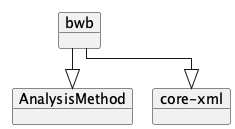<figcaption>class diagram bwb</figcaption></figure>
properties:

| Property | Type/Range | Cardinality | Definition |
| --- | --- | --- | --- |

## cvdr (method module)

The cvdrmethod is the official analysis and serialisation method for legal rulesets defined by Dutch local governments focused on the structure and presentation thereof. It also specifies how to refer to rulesets using a CVDR id which is to be used within the Juriconnect reference method. CVDR is based on Akoma Ntoso and XML serialisation.

See method repository-overheid-nl fore more information

### <dfn>cvdr</dfn>
 zie: https://www.overheid.nl/sites/default/files/pdf/Handleiding%2BSRU%2BBWB.pdf

subclass of: [https://cprmv.open-regels.nl/0.4.3/methods/module](https://cprmv.open-regels.nl/0.4.3/methods/module)

subclass of: <a>AnalysisMethod</a>

subclass of: <a>core.xml</a>

<figure id='concepts'><figcaption>class diagram cvdr</figcaption></figure>
properties:

| Property | Type/Range | Cardinality | Definition |
| --- | --- | --- | --- |

## dmn13 (method module)

The DMN 1.3 method is a well known formalisation method by the OMG Group to express Decision Models. 
It typically uses XML as a serialisation format.

### <dfn>dmn13</dfn>
 see https://www.omg.org/spec/DMN/1.3/About-DMN

subclass of: [https://cprmv.open-regels.nl/0.4.3/methods/module](https://cprmv.open-regels.nl/0.4.3/methods/module)

subclass of: <a>FormalisationMethod</a>

subclass of: <a>core.xml</a>

<figure id='concepts'>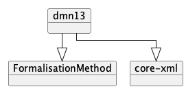<figcaption>class diagram dmn13</figcaption></figure>
properties:

| Property | Type/Range | Cardinality | Definition |
| --- | --- | --- | --- |

## sttr (method module)

The STTR method is a formalisation method based on DMN used within the Dutch environment law domain (Digitaal Stelsel Omgevingswet (DSO)). See https://iplo.nl/digitaal-stelsel/aansluiten/standaarden/sttr-imtr/ for more information.

### <dfn>sttr</dfn>
 see https://iplo.nl/digitaal-stelsel/aansluiten/standaarden/sttr-imtr/

subclass of: [https://cprmv.open-regels.nl/0.4.3/methods/module](https://cprmv.open-regels.nl/0.4.3/methods/module)

subclass of: <a>FormalisationMethod</a>

subclass of: <a>core.xml</a>

<figure id='concepts'>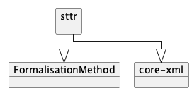<figcaption>class diagram sttr</figcaption></figure>
properties:

| Property | Type/Range | Cardinality | Definition |
| --- | --- | --- | --- |

## eli (method module)

The eli method is a well known reference method at EU level conforming to the ELI standard.

### <dfn>elinl</dfn>
 Experimental ELI for BWB and CVDR (Dutch standards)

subclass of: <a>ReferenceMethod</a>

<figure id='concepts'>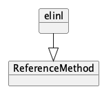<figcaption>class diagram elinl</figcaption></figure>
properties:

| Property | Type/Range | Cardinality | Definition |
| --- | --- | --- | --- |

### <dfn>elifmx4</dfn>
 ELI references to Formex 4 documents in EU CELLAR

subclass of: <a>ReferenceMethod</a>

<figure id='concepts'>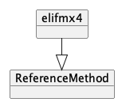<figcaption>class diagram elifmx4</figcaption></figure>
properties:

| Property | Type/Range | Cardinality | Definition |
| --- | --- | --- | --- |

## eucellar-fmx4 (method module)

### <dfn>eucellar-fmx4</dfn>
 see: ... 

subclass of: [https://cprmv.open-regels.nl/0.4.3/methods/module](https://cprmv.open-regels.nl/0.4.3/methods/module)

subclass of: <a>core.web</a>

subclass of: <a>fmx4</a>

<figure id='concepts'>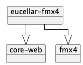<figcaption>class diagram eucellar-fmx4</figcaption></figure>
properties:

| Property | Type/Range | Cardinality | Definition |
| --- | --- | --- | --- |

## fmx4 (method module)

The fmx4 method is a well known analysis and serialisation method for, though mostly focused on the presentation of, legal ruleset's used by the EU's publication office. It typically serialises rules in a specific Akomo Ntoso compatible XML based format.

### <dfn>fmx4</dfn>
 see: ... 

subclass of: [https://cprmv.open-regels.nl/0.4.3/methods/module](https://cprmv.open-regels.nl/0.4.3/methods/module)

subclass of: <a>AnalysisMethod</a>

subclass of: <a>core.xml</a>

<figure id='concepts'>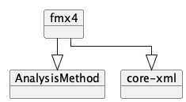<figcaption>class diagram fmx4</figcaption></figure>
properties:

| Property | Type/Range | Cardinality | Definition |
| --- | --- | --- | --- |

## juriconnect (method module)

The juriconnect method is a well known Dutch reference method.

### <dfn>juriconnect</dfn>
 Juriconnect (not fully supported yet)

subclass of: [https://cprmv.open-regels.nl/0.4.3/methods/module](https://cprmv.open-regels.nl/0.4.3/methods/module)

subclass of: <a>ReferenceMethod</a>

<figure id='concepts'>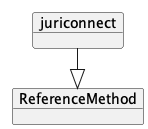<figcaption>class diagram juriconnect</figcaption></figure>
properties:

| Property | Type/Range | Cardinality | Definition |
| --- | --- | --- | --- |

## open-regels.nl (method module)

### <dfn>norms-backend.linkeddata.open-regels.nl</dfn>
 zie open-regels.nl

subclass of: <a>iou-norms</a>

<figure id='concepts'>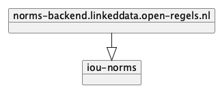<figcaption>class diagram norms-backend.linkeddata.open-regels.nl</figcaption></figure>
properties:

| Property | Type/Range | Cardinality | Definition |
| --- | --- | --- | --- |

### <dfn>operaton.open-regels.nl</dfn>
 zie open-regels.nl

subclass of: <a>iou-operaton</a>

<figure id='concepts'>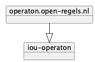<figcaption>class diagram operaton.open-regels.nl</figcaption></figure>
properties:

| Property | Type/Range | Cardinality | Definition |
| --- | --- | --- | --- |

## operaton (method module)

The Operaton method is a well known execution as well as publication method for BPMN process and DMN decision models.
It can be combined with the dmn13 method as such.

### <dfn>Operaton</dfn>
 

subclass of: [https://cprmv.open-regels.nl/0.4.3/methods/module](https://cprmv.open-regels.nl/0.4.3/methods/module)

subclass of: [https://cprmv.open-regels.nl/0.4.3/serve-api/core.web](https://cprmv.open-regels.nl/0.4.3/serve-api/core.web)

subclass of: <a>dmn13</a>

subclass of: <a>ExecutionMethod</a>

<figure id='concepts'><figcaption>class diagram Operaton</figcaption></figure>
properties:

| Property | Type/Range | Cardinality | Definition |
| --- | --- | --- | --- |

## digitaal-stelsel-omgevingswet (method module)

### <dfn>dso-service-register</dfn>
 DSO functioneleStructuurRef can be seen as (sub)services. As service register, the rulesetid is tied to one specific functioneleStructuurRef as well as organisation responsible for the rules.

subclass of: <a>ServiceRegister</a>

subclass of: <a>core.api</a>

subclass of: <a>core.json</a>

<figure id='concepts'>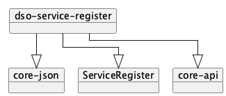<figcaption>class diagram dso-service-register</figcaption></figure>
properties:

| Property | Type/Range | Cardinality | Definition |
| --- | --- | --- | --- |

### <dfn>dso</dfn>
 see https://iplo.nl/digitaal-stelsel/

subclass of: <a>core.api</a>

subclass of: <a>sttr</a>

<figure id='concepts'><figcaption>class diagram dso</figcaption></figure>
properties:

| Property | Type/Range | Cardinality | Definition |
| --- | --- | --- | --- |

## register-overheids-organisaties (method module)

### <dfn>roo-catalogus</dfn>
 see https://organisaties.overheid.nl

subclass of: <a>OrganisationRegister</a>

subclass of: <a>core.api</a>

subclass of: <a>core.json</a>

<figure id='concepts'>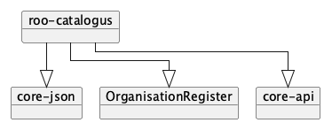<figcaption>class diagram roo-catalogus</figcaption></figure>
properties:

| Property | Type/Range | Cardinality | Definition |
| --- | --- | --- | --- |

### <dfn>roo-uri</dfn>
 see https://organisaties.overheid.nl

subclass of: <a>OrganisationRegister</a>

subclass of: <a>core.api</a>

subclass of: <a>core.json</a>

<figure id='concepts'>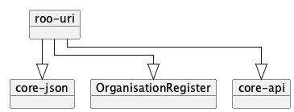<figcaption>class diagram roo-uri</figcaption></figure>
properties:

| Property | Type/Range | Cardinality | Definition |
| --- | --- | --- | --- |

### <dfn>roo</dfn>
 see https://organisaties.overheid.nl

subclass of: <a>OrganisationRegister</a>

subclass of: <a>core.api</a>

subclass of: <a>core.json</a>

<figure id='concepts'>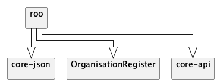<figcaption>class diagram roo</figcaption></figure>
properties:

| Property | Type/Range | Cardinality | Definition |
| --- | --- | --- | --- |

## iou (method module)

**Supported Rule Set Formats:**

1. **Operaton server at operaton.open-regels.nl:**
 - Format: `DMN1.3_{deploymentid}R{resourceid}_{date}_{index}` (A date and index must be provided but are not used)
 - Example: `DMN1.3_e62cb254-0e74-11f1-a5e9-f68ed60940f5Re62cb255-0e74-11f1-a5e9-f68ed60940f5_2026-01-01_1, LiteralExpression_2021`
 - Fetches from: http://operaton.open-regels.nl/

2. **IOU Norms API at open-regels.nl:**
 - Format: `IOU-NORMS_{rulesetid}_{date}_{index}` (A date and index must be provided but are not used)
 - Example: `IOU-NORMS_BWBR0015703_2026-01-01_1`
 - Fetches from: http://operaton.open-regels.nl/

### <dfn>iou-operaton</dfn>
 zie open-regels.nl

subclass of: <a>Operaton</a>

<figure id='concepts'>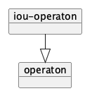<figcaption>class diagram iou-operaton</figcaption></figure>
properties:

| Property | Type/Range | Cardinality | Definition |
| --- | --- | --- | --- |

### <dfn>iou-norms</dfn>
 Sets of Norms from IOU Norms API V2 based on legal rules or Norm change announcement publications ahead of changes in legal rules

subclass of: <a>core.api</a>

subclass of: <a>core.json</a>

<figure id='concepts'>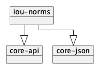<figcaption>class diagram iou-norms</figcaption></figure>
properties:

| Property | Type/Range | Cardinality | Definition |
| --- | --- | --- | --- |

## repository-overheid-nl (method module)

The repository.overheid.nl method is an official Dutch publication method (a web repository for official publications) for legal rulesets that are the output of the BWB and CVDR methods.

**Supported Rule Set Id formats:**

1. **BWB (Dutch Law Repository):**
- Format: `{BWB_ID}_{DATE}_{INDEX}` : retrieves the specific indicated version published on the given date with given index number
- Example: `BWBR0015703_2025-07-01_0` ([open with CPRMV API /rules endpoint](/rules/BWBR0015703_2025-07-01_0),[open with CPRMV API /raw endpoint](/raw/BWBR0015703_2025-07-01_0))
- Format: `{BWB_ID}_{DATE}_latest` : Retrieves the version valid on the date specified
- Example: `BWBR0015703_2025-07-02_latest`
- Format: `{BWB_ID}` : Retrieves the version valid on the current day
- Example: `BWBR0015703`
- Fetches from: https://repository.officiele-overheidspublicaties.nl/bwb/

2. **CVDR (Dutch Municipal Regulations):**
- Format: `{CVDR_ID}_{INDEX}` : retrieves the specific indicated with the given index number
- Example: `CVDR712517_1`
- Format: `{CVDR_ID}_{DATE}_latest` : Retrieves the version valid on the date specified
- Example: `CVDR712517_2025-07-02_latest`
- Format: `{CVDR_ID}` : Retrieves the version valid on the current day
- Example: `CVDR712517`
- Fetches from: https://repository.officiele-overheidspublicaties.nl/cvdr/

### <dfn>repository.overheid.nl-cvdr</dfn>
 zie repository.overheid.nl

subclass of: [https://cprmv.open-regels.nl/0.4.3/methods/frbr-sru](https://cprmv.open-regels.nl/0.4.3/methods/frbr-sru)

subclass of: <a>cvdr</a>

<figure id='concepts'>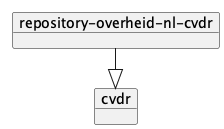<figcaption>class diagram repository.overheid.nl-cvdr</figcaption></figure>
properties:

| Property | Type/Range | Cardinality | Definition |
| --- | --- | --- | --- |

### <dfn>repository.overheid.nl-bwb</dfn>
 zie repository.overheid.nl

subclass of: [https://cprmv.open-regels.nl/0.4.3/methods/frbr-sru](https://cprmv.open-regels.nl/0.4.3/methods/frbr-sru)

subclass of: <a>bwb</a>

<figure id='concepts'>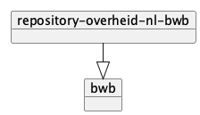<figcaption>class diagram repository.overheid.nl-bwb</figcaption></figure>
properties:

| Property | Type/Range | Cardinality | Definition |
| --- | --- | --- | --- |

